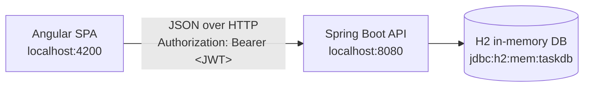
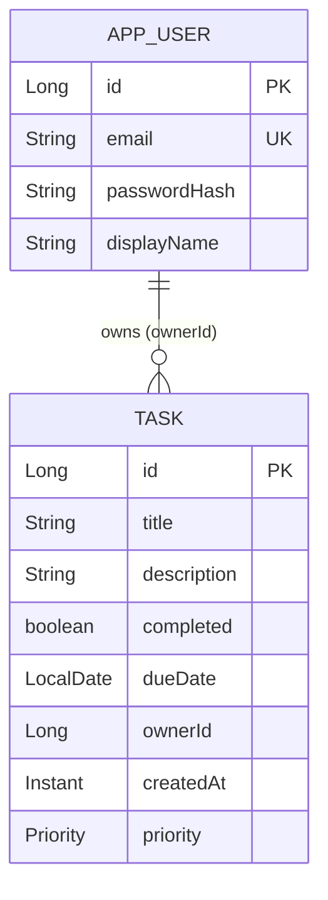
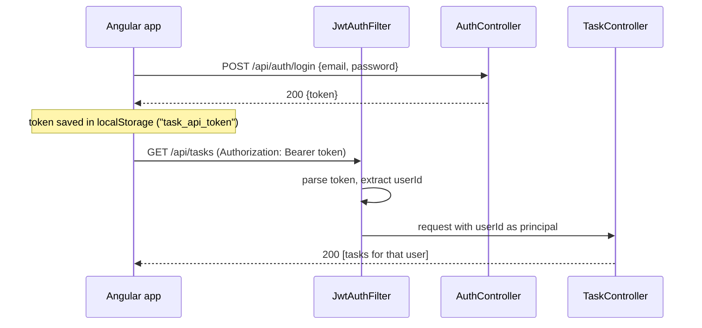

# Architecture

How the Task Manager is put together: a Spring Boot REST API (`backend/`) and an Angular single-page app (`frontend/`) that talk over JSON/HTTP, with stateless JWT authentication.

See also: [API reference](api.md) · [Frontend guide](../frontend/README.md) · [Project README](../README.md)

## System overview



| Layer | Technology |
|---|---|
| Backend | Java 17, Spring Boot 3.2, Spring Security 6, Spring Data JPA, jjwt 0.12 |
| Database | H2, in-memory (dev only, data is lost on restart) |
| Frontend | Angular 17 standalone components, RxJS, TypeScript (strict) |
| Auth | JWT (HMAC-signed), stateless, no server-side sessions |

## Backend

Base package: `com.technizer.taskapi` (`backend/src/main/java/com/technizer/taskapi/`).

| Package | Responsibility |
|---|---|
| `auth/` | `AuthController` (register/login), `AuthService` (credential logic), `JwtUtil` (create/parse tokens), `JwtAuthFilter` (per-request authentication) |
| `task/` | `TaskController`, `TaskService`, `TaskRepository`, `Task` entity, `Priority` enum |
| `user/` | `User` entity and `UserRepository` |
| `config/` | `SecurityConfig`: filter chain, CORS, password encoder |
| `exception/` | `GlobalExceptionHandler`: maps exceptions to JSON error bodies |

Each feature follows the same layering: **controller → service → repository**. Controllers hold request DTOs as nested Java records and return entities or records directly. Services hold the business rules. Repositories are Spring Data interfaces. All beans use constructor injection.

### Data model



- Table names are `app_user` and `task`. `Task.ownerId` is a plain `Long`, not a JPA relationship.
- `Task.priority` is an enum (`LOW`, `MEDIUM`, `HIGH`) stored as a string. It defaults to `MEDIUM`. **No endpoint currently sets it**: create and update do not accept a priority, so every task is `MEDIUM`. The field is returned in responses.
- `Task.dueDate` is optional and serialised as `yyyy-MM-dd`. `createdAt` is an ISO-8601 instant.

### Authentication flow



1. **Register / login** (`/api/auth/**` is public). `AuthService` hashes passwords with BCrypt. On success it returns a JWT.
2. **Token contents** (`JwtUtil`): subject = user ID, claim `email`, `iat`, and `exp`. Lifetime is `app.jwt.expiry-minutes` (default **60**). The signing secret comes from `app.jwt.secret` and must be at least 32 bytes.
3. **Every other request** passes through `JwtAuthFilter`, which reads `Authorization: Bearer <token>`, extracts the user ID and puts it in the Spring `SecurityContext` as the principal.
4. **Controllers** receive the caller's ID with `@AuthenticationPrincipal Long ownerId` and pass it to the service. Clients never send an owner ID.

### Security configuration (`SecurityConfig`)

- `/api/auth/**` and `/h2-console/**` are public. All other routes require authentication.
- Sessions are stateless and CSRF is disabled (no cookies are used for auth).
- CORS allows only `http://localhost:4200`, with methods GET, POST, PUT, PATCH, DELETE and OPTIONS.
- Frame options are disabled so the H2 console renders. This is for development only.

### Error handling

`GlobalExceptionHandler` converts exceptions to `{"error": "<message>"}` bodies:

| Exception | Status | Typical cause |
|---|---|---|
| `IllegalArgumentException` | 400 | Duplicate email, invalid credentials, blank title on update |
| `HttpMessageNotReadableException` | 400 | Malformed JSON or an invalid `dueDate` (body is `"Malformed request body"`) |
| `NoSuchElementException` | 404 | Task not found (or not owned by the caller, on update) |
| any other `Exception` | 500 | Body is a generic `"Unexpected server error"` |

Authentication failures never reach this handler. They are rejected by the security filter chain, so a missing, invalid or expired token produces an **empty-body 403**, not a 401 or a JSON error.

## Frontend

Source: `frontend/src/app/`. All components are standalone, with no NgModules.

```
app/
├── app.config.ts          providers: router + HttpClient with authInterceptor
├── app.routes.ts          '' → /login, /login, /tasks
├── app.component.*        root shell, just a <router-outlet>
├── auth/
│   ├── auth.service.ts    register / login / logout, token kept in localStorage
│   └── login.component.ts one form that toggles between login and register
├── core/
│   └── auth.interceptor.ts  adds Authorization: Bearer <token> to every request
└── tasks/
    ├── task.service.ts    HTTP calls for /api/tasks (the Task interface mirrors the backend entity)
    └── task-list.component.ts  list, add, set due date, complete, delete
```

- **Services own HTTP.** Components never call `HttpClient` directly. They call `AuthService` or `TaskService`, which return Observables.
- **Auth state is "a token exists in `localStorage`".** The interceptor attaches it to every outgoing request.
- **Routing:** `/` redirects to `/login`. After login or registration the app navigates to `/tasks`. There is no route guard.
- **API base URLs** are hard-coded to `http://localhost:8080` in the two services.

## Known limitations

Some of these are deliberate, as the project is a training demo. See the "Deliberate issues" section of the [README](../README.md).

- **Expired tokens are accepted.** `JwtUtil.isTokenValid()` always returns `true`. In practice an expired token still fails, because jjwt checks `exp` while parsing in `extractUserId()`. The failure surfaces as an empty-body 403.
- **Missing ownership checks.** `TaskService.markCompleted()` and `delete()` never compare the task's owner with the caller, so a user can complete or delete another user's task. `update()` does check, and returns 404 for tasks owned by others.
- **Bean Validation is inert.** The `@Email` and `@NotBlank` annotations on request records have no effect because no controller parameter uses `@Valid`. Only `update` enforces a non-blank title, in the service.
- **`DELETE` of a missing ID returns 200**, because `deleteById` is a silent no-op in Spring Data JPA 3.x.
- **403 instead of 401** for unauthenticated requests (no `AuthenticationEntryPoint` is configured).
- **Hardcoded demo JWT secret** in `application.properties`. Use an externally supplied secret for anything beyond local development.
- **Frontend gaps:** the UI has no logout button, doesn't check token expiry, and `TaskListComponent` has no error handlers, so failed calls fail silently.
